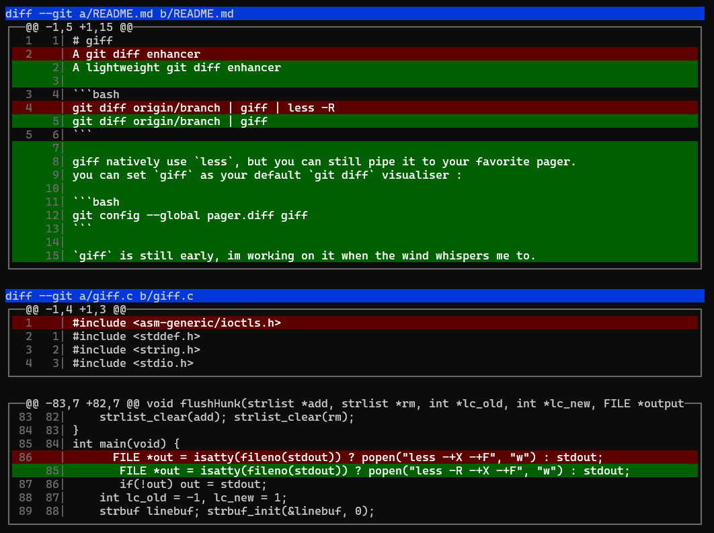

# giff
A lightweight git diff enhancer



```bash
git diff origin/branch | giff 
```

giff natively use `less`, but you can still pipe it to your favorite pager.
you can set `giff` as your default `git diff` visualiser :

```bash
git config --global pager.diff giff
```

`giff` is still early, im working on it when the wind whispers me to.
